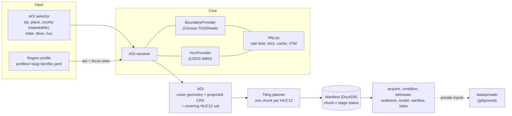

# hydrology-flow

General-purpose, reproducible watershed hydrology built only from public data. Pick an area of
interest (AOI), and the tool expands it to whole watersheds and works through them one HUC12 at a
time, so the same pipeline runs on a pond, a county or a state.

Worcester County, MA (Cook's Pond, Smith Pond and the dam between them) is the **reference
example** in `profiles/worcester-ma/`. It is data, not code: no geography appears in `src/`, and CI
enforces that.

> Screening-level analysis only. Not a substitute for a dam engineer or an Emergency Action Plan.
> No dam-breach inundation products are produced or published.

## Status

Scaffold (issue #2). The AOI resolver, region profiles, tiling planner, HTTP stack, telemetry and
CLI skeleton work. The pipeline stages (`acquire` through `bake`) are stubs that point at their
tracking issues. See the [epic](https://github.com/halcyondude/hydrology-flow/issues/1) and
[decisions and assumptions](docs/assumptions.md).

## Architecture



Design points:

- **A political boundary never cuts a watershed.** The AOI geometry is the union of the selected
  boundaries; the working set is every HUC12 that intersects it.
- **Larger-than-memory by construction.** Work is planned per HUC12 (or HUC10) and recorded in a
  resumable manifest; a crashed run picks up where it stopped.
- **Public-domain sources only.** Census TIGER/Line (via TIGERweb) and USGS WBD. Provenance is
  tracked in [`data/sources.yaml`](data/sources.yaml).
- **Pluggable providers.** `BoundaryProvider` and `HucProvider` are `Protocol` classes.
- **Observable, opt in.** One OpenTelemetry span, log line and metric per HTTP request. Off by
  default; `--telemetry console` prints to stderr, `--telemetry otlp` (or setting
  `HFLOW_OTLP_ENDPOINT`) exports over OTLP/gRPC.

## Quickstart

Requires [uv](https://docs.astral.sh/uv/) and Python 3.12+.

```sh
uv sync
uv run hflow --help
uv run hflow aoi --zip 01602
```

## AOI examples

```sh
# A ZIP code (Census ZCTA)
uv run hflow aoi --zip 01602

# A city (Census place)
uv run hflow aoi --place "Boulder, CO"

# One county, or several (their union is the AOI)
uv run hflow aoi --county "Worcester County, MA"
uv run hflow aoi --county "Worcester County, MA" --county "Middlesex County, MA"

# A county anywhere in the US
uv run hflow aoi --county "Travis County, TX"

# A whole state, written out as GeoJSON
uv run hflow aoi --state RI --out ri.geojson

# A bounding box (west south east north, EPSG:4326)
uv run hflow aoi --bbox -71.9 42.2 -71.8 42.3

# A hydrologic unit (2 to 12 digits)
uv run hflow aoi --huc 01090003

# A region profile
uv run hflow aoi --profile worcester-ma
```

The selectors are mutually exclusive, except that `--county` may be repeated. `--out FILE` writes a
GeoJSON Feature (EPSG:4326) whose properties carry the recommended projected CRS, source boundaries
and the full HUC12 list. HUC12s that overlap the AOI by less than 1% of their own area are
dropped and counted (`huc_min_overlap_fraction`, an `# ASSUMPTION:` with range 0 to 0.05). Results
are cached by content hash under `<repo>/.cache/hflow/`. Paths resolve from the repo root, not the
working directory; set `HFLOW_HOME` or `HFLOW_CACHE_DIR` to move them, and use `--no-cache` to
bypass the AOI cache.

## Region profiles

`profiles/<slug>/profile.yaml` holds everything site-specific: the AOI selector, focus sites
(`pond`, `dam`, `gauge`, `wq_site`, `parcel`) with optional coordinates and external ids, the
viewer's opening camera, and pointers into the gitignored `data/private/` tree. Unresolved values
are left unset and marked with `# ASSUMPTION:`; see
[`profiles/worcester-ma/profile.yaml`](profiles/worcester-ma/profile.yaml).

## Configuration

Environment variables (or `.env`), prefix `HFLOW_`: `HOME`, `CACHE_DIR`, `DATA_DIR`, `OTLP_ENDPOINT`,
`TELEMETRY_EXPORTER` (`console|otlp|none`, default none), `HTTP_CONCURRENCY`, `HTTP_RATE_PER_SECOND`,
`HTTP_BURST`, `HTTP_MAX_RETRIES`, `LOG_LEVEL`. Defaults and the assumptions behind them are in
[`src/hydrology_flow/config.py`](src/hydrology_flow/config.py).

## Contributing

See [CONTRIBUTING.md](CONTRIBUTING.md): geography is data not code, every assumption carries an
`# ASSUMPTION:` comment with a sensitivity range, and all HTTP goes through `hydrology_flow.http`.
