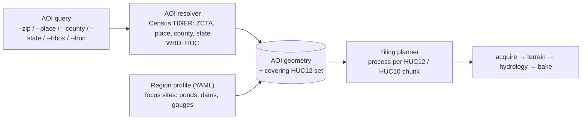

# Assumptions & Decisions

Living record of scope decisions and open assumptions. Every numeric modeling assumption lives in code config (or a region profile) with an `# ASSUMPTION:` comment and a sensitivity range. This file records the *why*.

## Decisions (confirmed by Matt, 2026-10-17)

| # | Decision |
|---|---|
| D1 | **General-purpose tool.** Geography is data, not code. Area of interest (AOI) is selected by ZIP code, city/state, one or more counties, a whole state, a bbox or a HUC. Worcester County, MA is the reference profile and proves the method. |
| D2 | **Two ponds, one dam.** Smith Pond and Cook's Pond are adjacent in Worcester, MA. Dam NID MA00123 sits between them. One consolidated group manages both ponds and the dam. |
| D3 | **Top committee priority: sediment and water quality.** That means erosion hotspots, sediment delivery, turbidity and phosphorus. Flood routing is still built because sediment transport depends on it, but it is sequenced second. |
| D4 | **Repo:** public `halcyondude/hydrology-flow`. The viewer deploys to GitHub Pages. Committee-private data (bathymetry, inspection reports, drawings) stays in a gitignored `data/private/` and is never committed. |
| D5 | **Scope:** hydrology only. TermTree is a separate workstream in a separate session. |

## Architecture consequences of D1

- **AOI resolution** uses only public-domain boundaries: Census TIGER/Line for ZCTA, place, county and state, plus the USGS WBD for HUCs. Watershed analysis always expands the AOI to the covering hydrologic units. A political boundary never cuts a watershed.
- **Region profiles** (`profiles/<slug>/profile.yaml`) hold everything site-specific: focus sites (Cook's Pond, Smith Pond, MA00123), named stations and private-data pointers. `profiles/worcester-ma/` is the reference.
- **Scale-out:** work is chunked by HUC12 (or HUC10) and stored as hashed, resumable intermediates. Resolution is tiered: 1 m lidar for focus-site subwatersheds, 10 m for the county or state.
- **No hard-coded geography in `src/`.** CI greps for it.

## Open assumptions (to verify)

| # | Assumption | How it gets resolved |
|---|---|---|
| A1 | Which pond is upstream of MA00123: Cook's (dam outlet to Tatnuck Brook) or Smith? | NHDPlus HR waterbodies + flowlines around 42.28425, -71.85749; confirm with Matt |
| A2 | Dam year completed (1830 vs 1920) and last inspection (2022-10-27 vs 2017-12-07) | NID API record MA00123 |
| A3 | Cook's Pond drainage area ≈ 18.8 km² | DEM delineation within ±10% of NHDPlusV2 COMID 6116810 |
| A4 | Spillway/outlet geometry unknown | Parameter with sensitivity bands until Haley Ward / committee drawings arrive |
| A5 | Worcester airport GHCN-D station = USW00094746 | NCEI station metadata |
| A6 | USGS 01109570 (Tatnuck Bk below Coes Res.) period of record | USGS Water Data API |

## Data requested from the committee (private, optional)

- WSU DEEP bathymetry (summer 2025), for both ponds if available
- Haley Ward inspection report; spillway/outlet drawings; EAP (internal reference only)
- Turbidity / water-quality monitoring data

## Standing constraints

- Screening-level analysis only. Not a substitute for the dam engineer or the EAP.
- **No dam-breach inundation products are published.**
